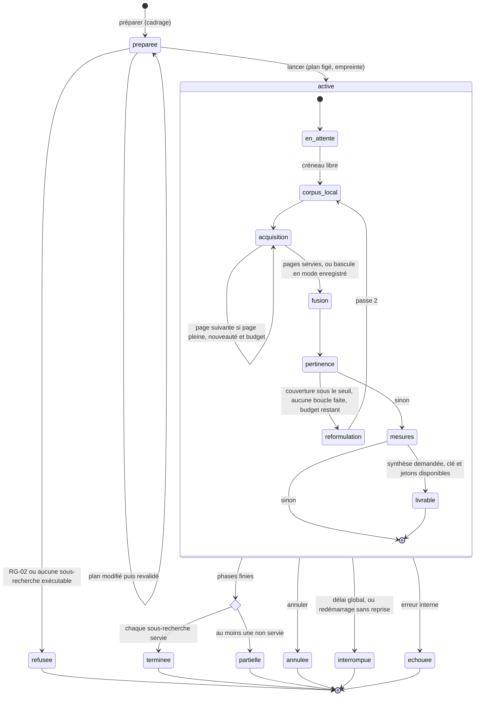

# ADR-0003 — Pipeline de recherche à phases : machine à états suivie par les écrans, sous-recherches typées par l'ontologie, routage des modèles Anthropic

- **Statut** : Proposée — 09/11/2026
- **Portée** : lot 2 du service (après le hackathon) : la recherche `POST /v1/recherches` et tout ce qui la prolonge (cadrage de la question, corpus local, acquisition Oriane, fusion, pertinence, reformulation, mesures par rôle, synthèse sourcée), son suivi par l'écran Recherche, et chaque appel du service à un modèle Anthropic. Plan : [plan-service-demonstration](../08_Plans/plan-service-demonstration.md), section « Lot 2 », fiches S21 à S39
- **Dépend de** / **Remplace** : [ADR-0001](0001-perimetre-et-pile-du-service.md) (pile close, inchangée : aucune dépendance ajoutée) ; [ADR-0002](0002-fournisseur-du-modele-de-langue.md) (Claude par `httpx`, configuration générique), dont elle amende un point : la liste de ce qui part vers le modèle, détaillée ici tâche par tâche. Ne remplace rien.

Conventions des chiffres : ceux du rapport de veille gardent son statut, (mesuré), (éditeur) ou (inférence, à confirmer) ; ceux du plan gardent le sien, (F) fait relevé, (E) estimation, (H) hypothèse ou réglage à confirmer ; « constaté » renvoie au code de `main` lu le 09/11/2026 (a0d4558). Les sections citées « veille § n » sont celles du rapport « Pipeline de recherche vidéo journalistique » du 09/11/2026 (dépôt privé de cadrage, cité par son titre) : § 1 sous-recherches bornées et échelle d'escalade, § 2 ontologie, § 3 métriques par rôle, § 4 observé, dérivé, jugé, § 5 API Claude et coût, § 6 parcours, § 7 nom et thème, conclusion et tableau des décisions.

## Contexte

- **Demande du propriétaire (09/11/2026).** « Pipeline de recherche, améliorations UX, optimisation inférence/recherche, ajout des modèles Anthropic. Inclut la pipeline en front-end. Modélise la pipeline par l'ingénierie des machines à états avec phases. Ces phases doivent être affichées sur le front-end Lovable pendant la recherche. »
- **Ce que fait le service aujourd'hui (constaté).** `POST /v1/recherches/preparer` traduit la question en filtres (`recherche.v1`) : reformulation par Sonnet 5.5 (`app/recherche_modele.py`, effort `low`, 300 jetons, 8 s) en noyaux de mots (`includesFuzzy`) et phrases exactes, repli déterministe. `POST /v1/recherches` exécute en une requête HTTP synchrone une seule page Oriane (100 résultats, 15 crédits (F)) où toutes les variantes partent en sous-requêtes nommées `or`, attribuées par `matchedQueries` ; une recherche donne un récit. La pertinence est une route à part (`POST /v1/recits/{id}/pertinence`, Haiku 5.5, lots de 10, trois en parallèle, 60 vidéos au plus, 6 000 jetons par lot). Les contenus partent dans le message utilisateur entre balises neutralisées, sans `cache_control` ni sortie structurée. Aucune trace de la recherche n'existe hors du journal des appels ; l'écran affiche « Recherche en cours… » et une durée fixe « environ 5 s » (dépôt des écrans, `src/components/recherche/Recherche.tsx`).
- **Ce que dit la veille.** Une chaîne bornée de trois à six sous-recherches typées, un seul aiguillage, une boucle corrective au plus, vaut mieux qu'un agent ouvert (§ 1) : la décomposition gagne +36,7 % de MRR@10 avec reclassement sur des questions à plusieurs faits (mesuré, Ammann et al.) mais coûte des secondes ; un système multi-agents consomme environ 15 fois les jetons d'un échange (éditeur, Anthropic). Le goulot est le budget Oriane, pas Claude : 600 crédits par jour font 40 pages de 100, moins de sept pages par utilisateur pour six personnes (inférence, calcul, § 1) ; d'où le corpus local d'abord et un cache exact (§ 4). La donnée se sépare en observé (immuable, attribué à Oriane), dérivé (reproductible, avec méthode, fenêtre, version) et jugé (humain, daté) (§ 4). Le coût Claude du POC tient entre 90 et 250 $ par mois pour six personnes (inférence, calcul, § 5). L'écran doit montrer le plan de recherche, des sous-recherches à états factuels et la preuve à côté de l'affirmation (§ 6). Aucune de ces recommandations n'a été mesurée sur de la vidéo sociale française : un jeu de 20 à 30 questions réelles tranche chaque marche (introduction et conclusion).
- **Contraintes du dépôt.** Pile close (ADR-0001, règle 4 de `CLAUDE.md`) : Python, FastAPI, pydantic, uvicorn, httpx, SQLite de la bibliothèque standard ; pas de SDK Anthropic, pas de file de tâches externe, pas de WebSocket (qui demanderait un paquet de plus pour uvicorn). Règles de confiance (règle 8) : liste blanche des champs d'Oriane en base et au journal, aucun libellé refusé dans un segment `libelle`, `methode` et `fenetre` sur chaque mesure, `mode` sur chaque réponse, transcription attribuée à Oriane, aucun test réseau. Une seule instance (risque « base SQLite dans un conteneur sans état » du plan), hébergée provisoirement dans un Codespace qui se met en veille (journal d'alignement du 09/11).
- **Ce qui manque et n'est pas inventé ici.** Oriane : seul le tri `publishedAt:asc` est relevé ; la pagination par `offset` existe dans la requête actuelle mais n'a jamais été exercée au-delà de 0 (H) ; aucune recherche sémantique ni score de pertinence n'est documenté ; l'heure dans la vidéo n'existe qu'au niveau `full` (`transcriptChunks`, refusé hors des deux vidéos comparées). SQLite : FTS5 est présent sur le poste (SQLite 3.50.4, constaté le 09/11) ; sa présence dans l'image `python:3.12` n'est pas vérifiée (H).

## Options

### 1. Forme de la recherche

| Option | Avantages | Inconvénients |
|---|---|---|
| A. Statu quo : une requête synchrone, pertinence à part | Rien à construire ; une page, 15 crédits (F) | Rien à montrer pendant l'attente ; aucune facette au-delà des variantes ; aucune trace rejouable ; le jeu d'or ne peut comparer qu'un bras |
| B. Agent ouvert ou multi-agents (marche 4 de la veille) | Couverture maximale sur les enquêtes longues | Environ 15 fois les jetons (éditeur) ; crédits Oriane non bornés ; défaillances décrites par Anthropic (sous-agents en nombre, recherche sans fin) ; peu testable sans réseau ; tool runner et Agent SDK hors pile |
| C. Chaîne déterministe à phases, machine à états, trois à six sous-recherches typées, une boucle au plus (marches 1 à 3) (retenue) | Chaque phase est nommable, bornée en crédits, jetons et temps, testable seule ; trace append-only rejouable ; le corpus local et le cache évitent de repayer ; l'écran suit des états factuels | Plus de code et de tables ; latence de quelques secondes à quelques dizaines de secondes ; gain non mesuré sur la vidéo sociale française tant que le jeu d'or n'existe pas |

Critères : crédits Oriane par recherche, jetons, latence perçue, traçabilité pour la rédaction, testabilité sans réseau, respect de la pile close. C l'emporte sur tous sauf la latence, que le suivi des phases rend lisible.

### 2. Exécution et suivi

| Option | Avantages | Inconvénients |
|---|---|---|
| A. Requête HTTP longue, synchrone | Aucun changement d'écran | Rien d'affichable pendant l'attente ; coupures par les proxys (Codespace, conteneur) ; annulation impossible |
| B. Tâche `asyncio` dans l'instance unique, suivi par interrogation `GET` (retenue) | Aucune dépendance ; fonctionne derrière tout proxy ; reprise après panne par le journal des transitions ; le navigateur n'a qu'un `fetch` de plus | Une requête par seconde et par écran pendant la recherche ; latence d'affichage d'une période d'interrogation |
| C. Même tâche, flux SSE (`StreamingResponse` de Starlette, `EventSource` du navigateur) | Aucune dépendance ; affichage immédiat | Comportement des proxys non vérifié (mise en tampon, délais d'inactivité) (H) ; une connexion ouverte par écran ; reconnexion à écrire |
| D. File externe (Redis, Celery, worker séparé) ou `BackgroundTasks` de FastAPI | File durable (externe) ; rien à écrire (`BackgroundTasks`) | Nouvelles dépendances et hébergement (externe) ; ni annulation, ni registre, ni reprise (`BackgroundTasks`) |

### 3. Persistance de l'état

| Option | Avantages | Inconvénients |
|---|---|---|
| A. État en mémoire | Simple | Perdu au redémarrage, donc perdu à chaque veille du Codespace |
| B. Ligne d'état réécrite | Lecture directe | Historique perdu ; reprise et audit impossibles |
| C. Journal append-only des transitions, état courant dérivé de la dernière (retenue) | Reprise, audit, rejeu ; conforme à la séparation observé, dérivé, jugé (veille § 4, Fowler cité) ; une contrainte `NOT NULL` porte la règle de méthode et de fenêtre | Une table de plus ; lecture de l'état par la dernière ligne |

### 4. Modèles

| Option | Avantages | Inconvénients |
|---|---|---|
| A. Sonnet 5.5 partout | Un seul réglage | Juger sur Sonnet plutôt que Haiku multiplie environ par 20 le coût d'une recherche simple (inférence, veille § 5) |
| B. Routage statique par tâche : Haiku 5.5 trie, Sonnet 5.5 planifie et rédige, Opus 5.5 sous condition d'évaluation, Fable écarté (retenue) | Capte l'essentiel du gain d'un routeur sans dépendance (inférence, § 5, RouteLLM mesuré par ses auteurs) | Deux espaces de cache, un par modèle |
| C. Routeur appris, ou SDK Anthropic et son tool runner | Gain de routage plus fin ; commodités du SDK | Entraînement et données absents ; nouvelle dépendance (ADR-0001) |

## Décision

Retenir **1C, 2B, 3C et 4B** : la recherche devient une **exécution** conduite par une machine à états à huit phases, lancée de façon asynchrone dans l'instance unique, suivie par l'écran Recherche par interrogation périodique d'un objet de suivi, persistée en transitions append-only, avec un routage statique des modèles Anthropic par tâche. Le flux SSE (2C) reste une option de second rang, construite seulement si le test d'usage le justifie (fiche S37). Le détail suit.

### D1. Les états et les phases

Huit phases, dans cet ordre fixe (version de la machine `phases.v1`) ; l'objet de suivi les liste toujours toutes, même celles qui ne tournent pas.

| Phase (`nom`) | Libellé affiché | Ce qu'elle fait | Nature de ce qu'elle produit | Ce qu'elle journalise |
|---|---|---|---|---|
| `cadrage` | Cadrage de la question | Au moment de préparer : aiguillage (simple ou à plusieurs facettes), facettes de la question vers une à six sous-recherches typées (D2), coût estimé ; le plan reste modifiable jusqu'au lancement | Dérivé (méthode : modèle et version de consigne, ou « règles v1 ») ; le plan modifié par le journaliste est un jugé (humain, daté) | Appel au modèle (`appel_llm`), refus RG-02, empreinte du plan |
| `corpus_local` | Corpus déjà rapatrié | Chaque sous-recherche interroge d'abord les segments déjà en base par FTS5 (D3) | Dérivé (BM25, méthode et version de l'index) | Nombre de segments et de vidéos trouvés, durée ; zéro crédit |
| `acquisition` | Recherche chez Oriane | Ne paie une page Oriane que pour une requête absente du cache exact ; regroupe les sous-recherches de même cadre en une requête à sous-requêtes nommées ; page suivante seulement si la page est pleine, la nouveauté suffisante et le budget suffisant | Observé, attribué à Oriane (projection de la liste blanche, segments) | Chaque appel (`appel_oriane` et `journal_appels` : filtres sans clé, page, crédits, code, durée) ; succès du cache ; bascule |
| `fusion` | Fusion et dédoublonnage | Union des vidéos par identifiant, rang par fusion RRF (k = 60) des listes BM25 de chaque sous-recherche ; ne fusionne jamais deux vidéos distinctes au texte identique (ce sont des versions, l'objet de l'écran Versions) | Dérivé (RRF, règle de dédoublonnage) | Vidéos avant et après, vidéos trouvées par plusieurs sous-recherches |
| `pertinence` | Pertinence | Haiku 5.5 annote chaque vidéo (`forte`, `faible`, `hors_sujet`, motif filtré), par lots de 10, sans jamais supprimer ni réordonner | Dérivé (modèle, version de consigne) : une annotation, jamais un verdict | Lots, vidéos jugées et non jugées, jetons |
| `reformulation` | Reformulation | Une fois au plus, sur règle codée (moins de `REFORMULATION_SEUIL_FORTES` vidéos de pertinence forte, ou au moins la moitié des sous-recherches vides) : Sonnet 5.5 propose au plus deux sous-recherches nouvelles, puis la chaîne repasse par `corpus_local`, `acquisition`, `fusion` et `pertinence` (passe 2) | Dérivé | Règle déclenchée, sous-recherches ajoutées ou refusées |
| `mesures` | Mesures par rôle | Calcule par code les mesures de chaque rôle (D4), chacune avec `methode`, `fenetre`, échantillon et plancher | Dérivé | Mesures calculées, masquées sous le plancher, non mesurables et pourquoi |
| `livrable` | Synthèse sourcée | Seulement si le plan le demande : extraction en JSON strict, puis rédaction avec citations natives (D5) | Dérivé, marqué « rédigé par un modèle de langue, à relire » ; les preuves pointent vers des segments observés | Deux appels, affirmations sourcées et non sourcées, jetons |

**États de l'exécution** (`etat`) : `preparee` et `refusee` appartiennent à la préparation et ne créent pas d'exécution ; une exécution naît `en_attente`, passe par les phases actives (`corpus_local`, `acquisition`, `fusion`, `pertinence`, `reformulation`, `mesures`, `livrable`) et finit dans un état terminal : `terminee` (chaque sous-recherche servie), `partielle` (au moins une sous-recherche non interrogée, vide en échec ou une phase en échec non bloquant : « 3 sous-recherches sur 4 interrogées »), `interrompue` (délai global dépassé ou redémarrage sans reprise ; les résultats déjà fusionnés restent servis), `annulee`, `echouee` (erreur interne du service seulement). **Statut d'une phase** : `en_attente`, `en_cours`, `terminee`, `partielle`, `ignoree` (non déclenchée, non demandée, ou repli faute de clé, de jetons ou de FTS5, avec sa raison), `echouee`, `annulee`. **Statut d'une sous-recherche** : `en_attente`, `en_cours`, `terminee`, `vide`, `non_interrogee` (budget), `refusee` (RG-02), `echouee`.



**Gardes**, évaluées par le moteur avant chaque unité de travail (une page Oriane, un lot de modèle) et jamais par une phase seule :

| Garde | Règle | Effet |
|---|---|---|
| G1 Budget de crédits de l'exécution | Crédits dépensés + 15 (une page (F)) ≤ `budget.credits` du plan (défaut `RECHERCHE_BUDGET_CREDITS`, 45 crédits soit trois pages (H)) | Sous-recherche `non_interrogee`, raison « budget de la recherche atteint » ; l'exécution continue |
| G2 Plafond de crédits du jour | Même verrou que la recherche et l'actualisation (S20) ; 600 crédits par jour (H) | Bascule du service en mode enregistré, comme aujourd'hui (S04) |
| G3 Plafond de jetons | Estimation majorée de l'entrée + `max_tokens` ≤ jetons restants de l'exécution (`RECHERCHE_PLAFOND_JETONS`, 60 000 (H)) et dépense du jour sous `PLAFOND_DEPENSE_MODELE_JOUR_USD` (7 $ (H), soit environ 150 $ par mois sur 22 jours, bas de la fourchette de plafond interne de la veille § 5) | Phase `ignoree` avec repli déterministe (D6), raison en clair |
| G4 Délais | Délai par appel (Oriane : `ORIANE_DELAI_S`, 20 s (H) ; modèle : par tâche, D6), délai global `EXECUTION_DELAI_GLOBAL_S` (120 s (H)) | Appel en échec (phase `partielle`) ; au-delà du délai global, `interrompue` avec les résultats déjà fusionnés |
| G5 RG-02 | Aucune sous-recherche ne porte sur le seul nom d'une personne (`personne_seule`, `nom_seul`, moins de trois mots pour une phrase exacte) ; la facette `qui` n'existe qu'en conjonction avec un propos ou comme filtre de compte | Sous-recherche `refusee` ; plan refusé (422) si aucune ne reste |
| G6 Bascule en mode enregistré | Deux pannes d'Oriane de suite, un 402 ou G2 (règles actuelles de `app/acquisition.py`) | `acquisition` finit `partielle`, l'exécution passe en `mode` `enregistre` avec `enregistre_le` et ne puise plus que dans la base et le cas ; l'écran l'affiche |
| G7 Annulation | Drapeau posé par `POST /v1/executions/{id}/annuler`, lu à chaque frontière d'unité ; un appel déjà parti finit et sa réponse est gardée (elle est payée) | `annulee` |
| G8 Une exécution active par recherche | L'identité d'une recherche est l'empreinte (SHA-256 du JSON canonique) de son plan figé | Un second lancement du même plan rend l'exécution active (200) ; un lancement identique dans les `EXECUTION_DEDOUBLONNAGE_S` (300 s (H)) qui suivent une fin rend l'exécution terminée (200) |
| G9 Concurrence | `EXECUTIONS_MAX_ACTIVES` (3 (H)) exécutions actives dans l'instance | Les suivantes restent `en_attente`, message « en file : N recherches avant la tienne » |
| G10 Boucle unique | `reformulation` ne tourne qu'une fois par exécution | Passe 2 au plus |

**Reprise après panne.** Chaque phase écrit ses sorties en une transaction à sa fin, clés par (exécution, phase, passe), puis la transition ; une phase rejouée réécrit des lignes nouvelles, la plus récente fait foi. Au démarrage (`lifespan` de `app/main.py`), toute exécution dont la dernière transition n'est pas terminale est reprise à la phase en cours si elle date de moins de `EXECUTION_REPRISE_AGE_MAX_S` (900 s (H)) et n'a jamais été reprise ; sinon elle passe `interrompue`, raison « service redémarré ». La reprise ne repaie rien : les pages Oriane viennent du cache exact, les appels au modèle de leur cache exact (D3, D6). À l'arrêt propre, les tâches sont annulées et laissent une transition « arrêt du service », reprise au démarrage suivant.

### D2. Le cadrage par l'ontologie

- **Ontologie.** Les douze classes et relations de la veille § 2 (`Video`, `Transcription` toujours attribuée à Oriane, `Propos`, `Version`, `Acteur`, `Lieu`, `Moment`, `Evenement`, `Recit`, `Sujet`, `Verification`, `Source`) vivent dans un fichier versionné `app/ontologie.v1.json`, validé par pydantic et chargé au démarrage ; aucun magasin RDF. Les noms de relation qui portent un libellé refusé sont renommés dans le contrat (la relation d'apparition la plus ancienne devient `plus_ancienne_trouvee`). Toute classe sans question de compétence associée est retirée avant la fiche S28 (veille § 2 : 15 à 25 questions types, relues par la rédaction).
- **Facettes vers sous-recherches typées** (tableau de la veille § 2, adapté aux filtres réellement relevés chez Oriane) :

| Facette (`facette`) | Classe ou relation | Sous-recherche émise | Limite |
|---|---|---|---|
| `quoi` | `Propos` | Noyau de mots (`mots`, `includesFuzzy`) et phrase clé exacte | Toujours présente |
| `variantes` | `variante_de` | Fragments et formulations courantes, mots dans n'importe quel ordre | Deux au plus |
| `qui` | `tenu_par` vers `Acteur` | Jamais seule (RG-02) : filtre de compte (`profileHandle.exactMatch`) ou nom joint à un propos | Si la question nomme un compte ou une personne |
| `lieu_moment` | `situe_a`, `situe_le` | Lieu nommé cherché comme mot dans la parole ou le texte à l'écran ; fenêtre de dates en filtre ; jamais un filtre de lieu d'Oriane (champs refusés par la liste blanche) | Si la question nomme un lieu ou une date |
| `plus_ancienne` | `plus_ancienne_trouvee` | Même propos, tri par date croissante (seul tri relevé), fenêtre élargie ; restitué « plus ancienne version retrouvée dans les sources consultées » | Une au plus |
| `recit` | `fait_partie_de`, `suite_de` | Variantes d'un récit déjà suivi au radar | Si la question renvoie à un récit suivi |

- **Aiguillage.** Une question entre guillemets, un lien collé ou une question à un seul propos donne un plan `simple` d'une ou deux sous-recherches (marches 0 et 1 de la veille) ; une question à plusieurs facettes donne un plan `multi_facettes` de trois à six sous-recherches (marche 2). Le cadrage par Sonnet 5.5 rend le plan en sortie structurée ; le repli sans clé est la traduction déterministe actuelle (`app/recherche.py`), une sous-recherche `quoi`.
- **Plan modifiable.** Le journaliste retire, ajoute (six au plus), réécrit une sous-recherche ou change son type, la fenêtre et les plateformes ; l'écran renvoie le plan à `POST /v1/recherches/preparer`, qui le revalide (G5, longueurs, limites), recalcule le coût et le rend ; ce qui est affiché est ce qui part (règle de S13, inchangée).

### D3. Corpus local d'abord, cache exact, fusion

- **Segments et FTS5.** Une table `segment` (un énoncé d'une vidéo, de la parole ou du texte à l'écran, avec vidéo, source « Oriane », langue si fournie, positions dans le texte ; heure « non fournie au niveau default ») et une table virtuelle FTS5 à contenu externe synchronisée par déclencheurs, tokenizer `unicode61` avec suppression des diacritiques, poids BM25 par colonne (veille § 4, documentation SQLite citée). Le tokenizer `trigram` (tolérance aux erreurs de transcription) n'entre que si le jeu d'or montre des échecs de graphie, et si la version de SQLite de l'image le permet (H). Si FTS5 manque à l'exécution, `corpus_local` passe `ignoree` avec sa raison et la chaîne continue. Les vidéos déjà en base sont indexées au démarrage, puis au fil de l'acquisition.
- **Cache exact Oriane.** Une table append-only `appel_oriane` : empreinte de la requête (JSON canonique du corps, des paramètres et de la page), corps sans clé, reçu le, crédits, code, total annoncé et **projection par la liste blanche** des résultats (identifiants et champs de `video.v1`). Écart assumé à la veille § 4, qui propose de garder le corps brut : la règle 8 interdit tout champ de tiers en base. Une requête dont l'empreinte a moins de `CACHE_ORIANE_FRAICHEUR_S` (86 400 s (H)) est servie sans appel, zéro crédit. Le mode enregistré et le banc d'évaluation se nourrissent de ce cache.
- **Acquisition sobre.** Les sous-recherches de même cadre (fenêtre, plateformes, comptes) partent en une requête à sous-requêtes nommées, comme aujourd'hui (une page, 15 crédits (F)) ; seules `plus_ancienne` et `qui`, qui changent le cadre, coûtent une page de plus. La page suivante d'un lot n'est demandée que si la page est pleine, si la part de vidéos inconnues de la page dépasse `PAGINATION_SEUIL_NOUVEAUTE` (30 % (H)) et si G1 le permet.
- **Fusion.** Les vidéos d'Oriane arrivent triées par date, pas par pertinence : leur ordre ne sert pas de rang. Après acquisition, chaque sous-recherche est rejouée sur FTS5 et les listes BM25 sont fusionnées par RRF (k = 60, veille § 4) ; l'ordre final est pertinence annotée, puis rang RRF, puis date. Les gains de la fusion de requêtes disparaissent souvent après reclassement (mesuré, un seul déploiement, veille § 1) : le jeu d'or juge sur la liste finale, pas sur le rappel brut.
- **Appartenance à un récit.** Assertion d'une exécution datée (`recit_video` : récit, vidéo, score, méthode, exécution), jamais une colonne de la vidéo (veille § 4) ; le radar reste servi par `recit.v1`.

### D4. Mesures par rôle

Calculées par code, jamais par le modèle, dans une table append-only `mesure` (vidéo ou récit, métrique, valeur, méthode, début et fin de fenêtre, date d'observation, échantillon) dont `methode`, `fenetre_debut` et `fenetre_fin` sont `NOT NULL`. Chaque mesure s'affiche avec sa méthode en une ligne, sa fenêtre, son échantillon et un plancher sous lequel elle est masquée avec sa raison (veille § 3).

| Rôle | Mesure | Calcul avec ce qu'Oriane rend | État |
|---|---|---|---|
| Journaliste | Occurrences du propos dans la parole et le texte à l'écran | Comptage sur les segments, avec fenêtre et périmètre | Calculable |
| Journaliste | Plus ancienne version retrouvée dans les sources consultées | Date de publication minimale du corpus interrogé | Calculable (existe en S05) |
| Journaliste | Extrait attribué | Compte, date, lien, segment ; heure « non fournie au niveau default » | Calculable |
| Chef de rédaction | Étendue de diffusion observée | Plateformes et comptes distincts, niveaux 1 à 3 seulement | Calculable |
| Chef de rédaction | Vitesse relative (vues gagnées par heure rapportées à la médiane du compte) | Exige deux relevés datés d'une même vidéo et une médiane par compte, absentes aujourd'hui | Non mesurée, raison « un seul relevé » ; la vitesse en vidéos par jour (S06, S19) reste servie |
| Chef de rédaction | Âge et phase de diffusion du récit | Âge, vitesse, étendue | Calculable, sans libellé de tendance |
| Rédaction | Récit en croissance sur une fenêtre | Regroupement daté par méthode | Calculable |
| Rédaction | Part de ses propres vidéos dans un récit | Filtre sur la liste des comptes de la rédaction (`CHEMIN_COMPTES_REDACTION`, hors Git) | Calculable si la liste est fournie, sinon non mesurée avec sa raison |

### D5. Synthèse sourcée en deux passes

Les citations natives et la sortie structurée s'excluent : leur combinaison renvoie une erreur (éditeur, veille § 5). La synthèse se fait donc en deux appels Sonnet 5.5 sur un corpus d'au plus 40 segments (hypothèse de volume de la veille § 5). **Passe 1** : extraction en sortie structurée ; chaque affirmation porte les identifiants de segments que le code vérifie contre la base de l'exécution (identifiant absent : affirmation rejetée et journalisée). **Passe 2** : rédaction en texte avec citations natives, un bloc `search_result` par segment ; le code ramène chaque citation à son segment et attache lui-même compte, date, lien et source « Oriane ». Toute phrase factuelle sans citation est gardée et marquée « non sourcé », jamais retirée en silence ; tout nombre absent des mesures fournies est marqué de même ; les chiffres viennent du service. La sortie passe le filtre de sortie (`app/filtre_sortie.py`) ; une rubrique « Ce que nous n'avons pas pu établir » reprend le non-cherché et les sous-recherches non servies. Les agents de recherche approfondie inventent 3 à 13 % des URL qu'ils citent (mesuré, préprint, veille § 1) : aucune adresse n'est rédigée par le modèle.

### D6. Modèles Anthropic

Appel direct de `POST /v1/messages` par `httpx` asynchrone, sans SDK, dans un client commun `app/claude.py` ; identifiants lus en configuration ; aucun réglage d'échantillonnage (refusé par les modèles 5.5, constaté).

| Tâche (variable de l'identifiant) | Phase | Modèle par défaut | Effort, réflexion | Sortie | Plafonds (H) | Ce qui part | Repli sans clé, sur refus ou sur échec |
|---|---|---|---|---|---|---|---|
| Cadrage (`MODELE_CADRAGE_ID`) | `cadrage` | `claude-sonnet-5-5` | `low`, `between_tools` | Structurée : plan | 1 500 jetons, 10 s | La seule question | Traduction déterministe actuelle |
| Pertinence (`PERTINENCE_MODELE_ID`, existant) | `pertinence` | `claude-haiku-5-5` | `low`, réflexion désactivée | Structurée : niveaux et motifs | Lots de 10, 6 000 jetons par lot (constaté), 12 s, trois lots en parallèle, 60 vidéos | Question ; par vidéo : identifiant, plateforme, légende 300, texte à l'écran 300 et extrait de transcription 1 200 caractères (constaté), plus le compte | Vidéos sans annotation, phase `partielle` ou `ignoree` |
| Reformulation (`MODELE_REFORMULATION_ID`) | `reformulation` | `claude-sonnet-5-5` | `low`, `between_tools` | Structurée : deux sous-recherches au plus | 800 jetons, 10 s | Question, plan, compteurs par sous-recherche, dix extraits de vidéos de pertinence forte | Pas de boucle |
| Synthèse (`MODELE_LIVRABLE_ID`) | `livrable` | `claude-sonnet-5-5` ; `claude-opus-5-5` seulement si S36 montre un gain visible | `low` | Passe 1 structurée ; passe 2 texte et citations | 4 000 puis 2 000 jetons, 30 s par passe | 40 segments au plus (texte et identifiant), mesures calculées | Phase `ignoree` ; la fiche garde son gabarit (S08) |
| Filtre d'injection (`MODELE_FILTRE_ID`, vide par défaut) | Avant `reformulation` et `livrable` | `claude-haiku-5-5` | `low`, réflexion désactivée | Structurée `{injection_suspectee: bool}` ; un refus vaut suspicion | 50 jetons | Les mêmes contenus | Contenu suspect retiré du lot et journalisé |
| Résumé de fiche (`MODELE_LANGUE_ID`, existant, S10) | Hors exécution | `claude-sonnet-5-5` | Inchangé | Inchangé | Inchangés | Inchangé (ADR-0002) | Gabarit |

- **Fable écarté** : 10 / 50 $ par million de jetons, cinq fois Sonnet 5.5 (2 / 10 $), avec une rétention de 30 jours imposée (éditeur, veille § 5). **Opus 5.5** (4 / 20 $, éditeur) n'entre que par la fiche S36, sur le jeu d'or.
- **Contenus des vidéos, données non fiables.** Ils partent uniquement dans un bloc `tool_result` encodé en JSON, après un tour `assistant` portant un `tool_use` écrit par le code (outil unique de lecture, déclaré à l'identique dans chaque appel d'une tâche), avec la politique écrite dans la consigne système : une instruction trouvée dans un contenu est un propos rapporté, jamais un ordre (éditeur, veille § 5). La consigne de la tâche suit le résultat d'outil, dans le même tour utilisateur. Le modèle n'a aucun outil d'action : sa sortie passe toujours par la validation du service (moindre privilège). Le compte n'est plus envoyé au modèle (minimisation : il ne sert pas au jugement), ce qui resserre la pratique actuelle de la pertinence. Hypothèse à vérifier par un test `reel` de S23 : un tour `assistant` sans bloc de réflexion est accepté avec la réflexion `between_tools` ou désactivée ; à défaut, le JSON encodé passe dans un bloc `search_result` du tour utilisateur.
- **Sortie structurée** : `output_config.format` de type `json_schema` ; le schéma n'accepte ni bornes de longueur ni récursion (éditeur), pydantic revalide donc tout ; une coupure par `max_tokens` ou un `stop_reason` `refusal` vaut échec du lot, journalisé, avec le lecteur tolérant actuel en secours pour la pertinence.
- **Cache de prompt.** Préfixe stable, identique à l'octet près : outils, puis consigne de la tâche, puis un **dictionnaire de données** en français d'environ 4 Ko (définition de chaque mesure, sens de « récit », vocabulaire imposé, règle des libellés, classes de l'ontologie), marqué `cache_control` éphémère. Le dictionnaire a fait gagner 17 à 23 points de justesse sur 100 questions analytiques, en texte vers SQL (mesuré, veille § 5) ; le transfert à cet usage n'est pas garanti (inférence). Le cache se déclenche dès 512 jetons sur la gamme 5.5 et se relit à 0,1 fois le prix d'entrée, 0,05 fois sur Sonnet et Opus (éditeur) ; changer d'outils, d'effort ou de format l'invalide, et il est propre à chaque modèle. Les deux passes de la synthèse changent de format : le gain du cache entre elles est à mesurer, pas supposé (H). Contrôle : `usage.cache_read_input_tokens` non nul sur des appels répétés.
- **Cache exact des appels** (`appel_llm`, append-only) : modèle, version de consigne, empreinte de l'entrée, sortie **validée et filtrée** (jamais la réponse brute), jetons d'entrée, de sortie, de cache lus et écrits (champ `usage`), `stop_reason`, durée, code. Une entrée identique de moins de 24 h (H) ne repart pas : zéro jeton, et la reprise après panne ne repaie rien.
- **Erreurs.** Un 429 `enforced_spend_limit_reached` (plafond de dépense du palier, 500 $ en Start, sans `retry-after` (éditeur)) n'est jamais réessayé : phases de modèle `ignoree`, message « budget du modèle épuisé ». Un 429 ordinaire, 529 ou 5xx est réessayé une fois après `retry-after` ou 2 s (H), dans le délai de la phase. Le repli serveur des refus (`fallbacks`, en bêta) n'est pas activé : il changerait le modèle qui a jugé ; condition de révision ci-dessous.
- **Coût attendu** : 90 à 250 $ par mois selon le scénario (inférence, calcul, veille § 5, aux hypothèses de volume de la veille) ; la recherche raffinée coûte environ 12 fois la simple (inférence) ; les modèles 5.5 produisent environ 30 % de jetons de plus que Sonnet 4.6 pour un même texte (éditeur). Le cumul du champ `usage` en base donne la mesure réelle.

### D7. Le contrat (rétrocompatible avec `api.v1`)

Tout est additif : routes nouvelles, champs optionnels nouveaux ; le titre du contrat reste `api.v1` et `GET /v1/etat` rend toujours `"contrat": "api.v1"`. Les écrans actuels, qui n'appellent aucune route nouvelle, ne changent pas. Nouveaux schémas exportés : `plan.v1`, `execution.v1`, `livrable.v1`.

| Route | Clé de démonstration | Corps | Réponses |
|---|---|---|---|
| `POST /v1/recherches/preparer` (existante) | Oui (POST) | `{"question": …, "plan"?: plan.v1}` | 200 `Recherche` portant en plus `plan` (optionnel) |
| `POST /v1/executions` | Oui | `{"question": …, "plan"?: plan.v1}` (plan absent : celui de `preparer`) | 202 `Execution` créée, en-tête `Location` ; 200 `Execution` active ou récente (G8) ; 422 `validation` (refus, plan invalide) ; 401 |
| `GET /v1/executions/{id}` | Non | — | 200 `Execution` ; 404 |
| `GET /v1/executions/{id}/resultat` | Non | — | 200 `ResultatExecution` ; 409 `execution_en_cours` ; 404 |
| `POST /v1/executions/{id}/annuler` | Oui | `{}` | 200 `Execution` (rendue telle quelle si déjà terminale) ; 404 |
| `POST /v1/recherches` (existante) | Oui | Inchangé | Inchangées : crée une exécution au profil `rapide` (cadrage, corpus local, acquisition, fusion), l'attend au plus `DELAI_RECHERCHE_SYNCHRONE_S` (30 s (H)) et rend `ResultatRecherche` comme aujourd'hui |

**Forme exacte de l'objet de suivi** (`execution.v1`, réponse de `GET /v1/executions/{id}`) :

```json
{
  "mode": "direct",
  "enregistre_le": null,
  "identifiant": "exe-3f9c2a71b0d4",
  "machine": "phases.v1",
  "question": "Que disent les vidéos sur le pouvoir d'achat depuis un mois ?",
  "plan": { "version": "plan.v1", "empreinte": "…", "aiguillage": "multi_facettes", "sous_recherches": ["…"], "budget": { "credits": 45, "jetons": 60000 }, "synthese": false },
  "etat": "acquisition",
  "terminal": false,
  "numero": 6,
  "cree_le": "2026-11-12T09:14:02+00:00",
  "debut": "2026-11-12T09:14:02+00:00",
  "fin": null,
  "message": "Recherche chez Oriane : 2 sous-recherches sur 4 interrogées",
  "phases": [
    {
      "nom": "corpus_local",
      "libelle": "Corpus déjà rapatrié",
      "statut": "terminee",
      "passe": 1,
      "debut": "2026-11-12T09:14:02+00:00",
      "fin": "2026-11-12T09:14:02+00:00",
      "nature": "derive",
      "methode": "FTS5 unicode61 sans diacritiques, BM25 par colonne, index v1",
      "compteurs": { "sous_recherches": 4, "segments": 212, "videos": 37 },
      "cout": { "credits": 0, "jetons_entree": 0, "jetons_sortie": 0, "jetons_cache_lus": 0 },
      "message": "37 vidéos déjà en base pour 4 sous-recherches, sans crédit",
      "raison": null
    }
  ],
  "sous_recherches": [
    { "identifiant": "sr-1", "facette": "quoi", "requete": "pouvoir d'achat", "type": "mots", "statut": "terminee", "source": "oriane", "videos": 64, "nouvelles": 41, "pages": 1, "credits": 15, "raison": null }
  ],
  "cout": { "credits_estimes": 30, "credits_depenses": 15, "plafond_credits": 45, "jetons_entree": 1840, "jetons_sortie": 212, "jetons_cache_lus": 3100, "plafond_jetons": 60000, "methode": "15 crédits par page de 100 résultats au niveau default (estimation) ; jetons selon le champ usage des réponses" },
  "raison_fin": null,
  "prochaine_lecture_ms": 1000,
  "resultat": null
}
```

- `phases` porte toujours les huit phases, dans l'ordre de D1 ; `compteurs` n'a que des entiers, avec des clés documentées par phase dans le contrat ; `cout` d'une phase et de l'exécution additionnent les crédits estimés et le champ `usage` des réponses du modèle ; `passe` vaut 0 tant que la phase n'a pas tourné, 2 après la reformulation.
- `message` de l'exécution et de chaque phase sont des libellés produits par des gabarits fixes à trous numériques, jamais par un modèle, et passés au filtre des libellés refusés par les tests. Exemples : « 4 sous-recherches prévues, coût estimé 30 crédits » ; « 37 vidéos déjà en base, sans crédit » ; « 3 sous-recherches sur 4 interrogées : budget de la recherche atteint pour la dernière » ; « 112 vidéos après fusion, 9 trouvées par plusieurs sous-recherches et comptées une fois » ; « Pertinence jugée par un modèle de langue pour 60 vidéos sur 112 (plafond de 60) » ; « Aucune reformulation : 23 vidéos de pertinence forte » ; « 6 mesures calculées, 2 masquées sous le plancher » ; « Synthèse rédigée par un modèle de langue, à relire : 5 affirmations, 1 non sourcée » ; « Mode enregistré : Oriane injoignable, résultats tirés du cas enregistré le 06/11/2026 ». `requete` d'une sous-recherche est une citation (le texte cherché), jamais filtrée, comme `phrase_surveillee`.
- `prochaine_lecture_ms` dit à l'écran quand relire (`SUIVI_INTERVALLE_MS`, 1 000 ms (H)) ; `null` une fois terminal. `resultat` vaut le chemin de `GET /v1/executions/{id}/resultat` dès que la fusion est faite.
- `ResultatExecution` : `mode`, `enregistre_le`, `execution`, `recherche` (`Recherche`), `recit` (`Recit`, avec `sous_recherches`), `mesures_par_role` (`journaliste`, `chef_de_redaction`, `redaction` : listes de `Mesure`), `livrable` (`livrable.v1` ou `null` : `methode`, `modele`, `mention` « rédigé par un modèle de langue, à relire », `affirmations` [{segments `libelle`, `preuves` [{segment, vidéo, extrait `citation` de 40 mots au plus, source « Oriane », compte, `publie_le`, lien, heure « non fournie au niveau default »}], `sourcee`}], `non_etabli` [segments `libelle`]).
- `plan.v1` : `version`, `empreinte` (calculée par le service), `aiguillage` (`simple`, `multi_facettes`), `methode`, `modifie_par_journaliste`, `cadre` {`fenetre`, `plateformes`, `comptes`, `comptes_exclus`}, `sous_recherches` (une à six : `identifiant`, `facette`, `requete`, `type` `mots` ou `exacte`, `dans` `parole_ou_ecran`, `parole` ou `ecran`, `cadre_propre` optionnel, `raison` libellé fixe par facette, `refus` optionnel), `budget` {`credits`, `jetons`}, `synthese`, `cout_estime` {`credits_estimes`, `jetons_estimes`, `methode`}.
- Codes d'erreur ajoutés à l'enveloppe unique : `execution_en_cours` (409). Toute réponse nouvelle porte `mode` et, en mode enregistré, `enregistre_le`.
- **Flux SSE réservé** : `GET /v1/executions/{id}/flux` (`text/event-stream`, un événement par transition, même objet que le `GET`), absent du contrat tant que la fiche S37 n'est pas lancée. Elle ne l'est que si le test d'usage montre que la période d'interrogation gêne la lecture des phases et si un essai derrière l'hébergement réel (Codespace ou conteneur) passe sans mise en tampon.

### D8. Persistance

Nouvelles tables dans le même fichier SQLite, créées par les modules qui les possèdent (le magasin `documents` et `journal_appels` de S01 reste intact) : `execution` (plan figé, empreinte, question, créée le, mode à la création) et `transition` (exécution, numéro, de, vers, phase, statut, passe, horodatage, compteurs, coût, message, raison), toutes deux en insertion seule ; `segment` et sa table FTS5 ; `appel_oriane` ; `appel_llm` ; `mesure` ; `recit_video`. Mode WAL activé par `PRAGMA` (bibliothèque standard) pour que les lectures du suivi ne bloquent pas l'écrivain. Aucune de ces tables ne reçoit un champ hors de la liste blanche ni une réponse brute ; chaque transition laisse aussi une ligne `execution.transition` au journal des appels, sans contenu.

### Ce qui reste hors de cette ADR

| Sujet | Pourquoi | Voie |
|---|---|---|
| Index vectoriel (sqlite-vec et modèle d'embedding), fusion hybride | Nouvelles dépendances ; à n'envisager que si FTS5 échoue sur des paraphrases du jeu d'or (veille § 4, rang 7) | ADR séparée, révise l'ADR-0001 |
| Hébergement durable (fin du Codespace) | Décision d'hébergement ; conditionne la reprise après panne et le flux SSE | ADR séparée, déjà inscrite à la porte suivante du plan |
| Nom du produit | Décision du propriétaire ; risque de droit antérieur (veille § 7, ce n'est pas un avis juridique) ; touche le titre du contrat et la licence | Décision du propriétaire, ADR conseillée ; fiches S38 et S39 prêtes, sans nom |
| Traitement en Europe ou sans conservation | L'API directe n'offre que `us` et `global` (éditeur, veille § 5) | ADR séparée, amende l'ADR-0002 |
| Nouvelles sources (vérifications publiées, recherche web de Claude) | Nouvelle source de données | ADR séparée |
| API Batch pour le différable (évaluations, fiches préparées) | Moitié prix (éditeur), mais non éligible à la non-conservation | Fiche ultérieure si la dépense mesurée dépasse 200 $ par mois |
| Thème clair, sombre ou système des écrans | Hors dépôt, sans contrat (veille, tableau des décisions) | Fiche S24, sans ADR |

## Conséquences

- **Ce que cela change.** La recherche devient observable phase par phase ; l'écran Recherche affiche le plan avant lancement, puis les huit phases, les sous-recherches et leurs coûts pendant l'exécution ; `POST /v1/recherches` reste servi à l'identique. Les modules `app/recherche_modele.py` et `app/pertinence.py` passent sur le client commun ; les appels au modèle gagnent sortie structurée, `tool_result` JSON, cache de prompt et comptage du champ `usage`.
- **Ce que cela coûte.** Sept tables nouvelles, un moteur d'états, 19 fiches (plan, lot 2, dont quatre sous condition), cinq relues par `opus` ; une requête de suivi par seconde et par écran pendant une recherche ; des crédits Oriane bornés par G1 (trois pages par recherche par défaut (H)) et un plafond de dépense Claude interne (G3).
- **Ce qu'il faut surveiller.** Crédits du jour et taux de succès du cache Oriane ; `usage.cache_read_input_tokens` ; part des exécutions `partielle` et `interrompue` ; latence par phase ; dépense mensuelle mesurée (alerte au-delà de 150 $) ; le jeu de transcriptions piégées (S35).
- **Ce qui attend l'acceptation.** Les fiches S21, S23 et S25 à S37, directement ou par leurs dépendances ; le banc d'évaluation (S22) et le thème (S24) n'en dépendent pas ; le renommage (S38, S39) attend le nom, pas cette ADR.
- **Conditions de révision.** Le jeu d'or montre que la requête unique couvre déjà les questions réelles (la marche 2 devient superflue : on garde le suivi des phases, on réduit le plan à une sous-recherche) ; une documentation Oriane révèle une recherche sémantique, un tri par pertinence ou un barème différent (D3 se simplifie) ; le test piégé fuit (le filtre d'injection devient obligatoire) ; une petite évaluation montre qu'une seule passe suffit à la validité des citations (D5 se réduit) ; les refus du modèle dépassent 5 % des appels d'une tâche (H) (activer le repli serveur et journaliser le modèle qui a répondu) ; l'hébergement durable impose plusieurs instances (le registre en mémoire et la reprise passent en base partagée, ADR nouvelle) ; une exigence de résidence des données.

## Amendement A1 — Pipeline en sept étapes (Qualifier, Planifier, Chercher, Lire, Revoir et seuiller, Produire, Vérifier)

- **Statut** : Proposée — 10/11/2026 (demande du propriétaire du même jour).
- **Sources** : Anthropic, « How we built our multi-agent research system », 13/06/2025 ; LangChain, « Open Deep Research », juillet 2025 ; Google, Gemini Deep Research, décembre 2024 ; CRAG, arXiv 2401.15884, 29/01/2024 ; Stop-RAG, arXiv 2510.14337, 16/10/2025 ; VeriCite, arXiv 2510.11394, 13/10/2025 ; CiteEval, arXiv 2506.01829, juin 2025 ; note de veille « RAG agentique et pipelines multi-recherche ».

**Décision proposée.** Adopter les sept étapes comme grille de l'écran, par un champ `etape` sur chaque phase, sans `phases.v2` : six existent déjà dans `phases.v1`, à trois écarts près (passages lus, seuils chiffrés, vérification par affirmation). Ajouter une seule phase, `verification`, neuvième de `phases.v1`, à inscrire avant S21 tant qu'aucun client ne lit `execution.v1` ; le propriétaire décide.

### A1.1 Correspondance

| Étape | Phase(s) (D1) | Couverture | État de l'art | Écart |
|---|---|---|---|---|
| Qualifier | `cadrage` (aiguillage, G5) | Partielle | Aiguillage par complexité (Adaptive-RAG) ; clarification (Open Deep Research) | Règles codées avant le modèle ; le plan modifiable tient lieu de clarification |
| Planifier | `cadrage` (plan, budget) | Couverte | Plan modifiable avant exécution (Gemini) | Aucun |
| Chercher | `corpus_local`, `acquisition`, `fusion` | Couverte | Commencer large, puis resserrer (Anthropic) | Aucun |
| Lire | `pertinence` | Partielle | Passages ciblés, l'inutile écarté (CRAG) | Haiku lit les 1 200 premiers caractères (constaté, `app/pertinence.py`) : le code choisira les meilleurs segments BM25, sans jeton |
| Revoir et seuiller | `pertinence`, `reformulation` | Partielle | Évaluateur léger (CRAG) ; arrêt appris, mais entraîné (Stop-RAG) | `REFORMULATION_SEUIL_FORTES` sans valeur ; aucun seuil d'entrée de `livrable` ; boucle unique gardée (G10) |
| Produire | `mesures`, `livrable` | Couverte | Rédiger après la recherche (LangChain) | Aucun |
| Vérifier | `livrable`, passes 1 et 2 | Manquante | Agent de citation (Anthropic) ; inférence textuelle par affirmation (VeriCite, CiteEval) | D5 garantit qu'une citation pointe vers un segment fourni, pas qu'il soutient l'affirmation |

### A1.2 Coût par étape

Exécution `multi_facettes` avec synthèse ; par million de jetons : Haiku 5.5 0,10 / 0,50 $, Sonnet 5.5 2 / 10 $ (éditeur, veille § 5).

| Étape | Modèle | Crédits | Jetons entrée / sortie | Coût |
|---|---|---|---|---|
| Qualifier | Code | 0 | 0 | 0 |
| Planifier | Sonnet 5.5 | 0 | 2 500 / 800 (H) | 0,013 $ (E : 2 500 × 2 + 800 × 10) |
| Chercher | Code | 15 à 45 (G1) | 0 | Crédits seuls |
| Lire | Code (FTS5) | 0 | 0 | 0 |
| Revoir et seuiller | Haiku 5.5 ; Sonnet 5.5 (reformulation) | 15 en passe 2, sous G1 | Six lots de 6 500 / 600 (H) ; reformulation 3 000 / 800 (H) | 0,006 $ la passe (E : 6 × (650 + 300) millionièmes) ; reformulation 0,014 $ (E) |
| Produire | Code, puis Sonnet 5.5 en deux passes | 0 | 10 000 / 6 000 au plus (H) | 0,08 $ au plus (E : 10 000 × 2 + 6 000 × 10) |
| Vérifier | Code, puis Haiku 5.5 | 0 | 4 500 / 300 pour dix affirmations (H) | 0,001 $ (E) |

Exécution complète, boucle comprise : 0,12 $ au plus (E, somme) et 45 crédits (G1), sous les 7 $ du jour (G3). Écart : une passe de pertinence (42 600 jetons (E)) laisse 17 400 des 60 000 de G3, moins que les 22 000 majorés (H) de `livrable` et `verification` ; avec synthèse, le moteur les réserve d'abord et la pertinence finit `partielle`.

### A1.3 Seuils

Trente questions du banc S22 (`02_Service/evaluation/`) font un contrôle de cohérence, pas une inférence.

| Seuil | Valeur (H) | Calibrage sur S22 |
|---|---|---|
| Passages lus | Trois segments BM25 par vidéo, 1 200 caractères | Préfixe contre passages : garder si la précision de `forte` monte sans perte de rappel@10 |
| Fiabilité de `forte` | Précision 0,8, rappel 0,7 contre les vidéos trouvées à la main | En dessous, revoir la consigne |
| Entrée de `livrable` | `forte` seules ; `faible` ajoutées sous cinq `forte` ; 40 segments (D5) | Faits couverts par les segments retenus |
| Boucle | Moins de cinq `forte`, ou moitié des sous-recherches vides | Essayer 3, 5 et 8 (bras `multi`, `boucle`) : la plus basse qui garde les gains ; boucle sur moins d'un tiers des questions |
| Vérification | `soutenue` si Haiku et le code (identifiants, extrait exact, chiffres) concordent ; plus de 30 % `non_soutenue` : synthèse « à reprendre » | 30 affirmations annotées à la main, hors Git : accord 0,8, sinon Sonnet 5.5 vérifie |

### A1.4 Contrat

- Accepté avant S21, l'amendement garde `api.v1` et `machine: phases.v1` : `execution.v1` n'est ni écrit ni lu (S21, S31 à faire), la liste passe à neuf phases sans client à casser.
- Additions optionnelles : `etape` par phase ; `verification` (`statut` `soutenue`, `partielle` ou `non_soutenue`, `methode`) par affirmation de `livrable.v1` ; compteurs `passages_lus`, `affirmations_verifiees`.
- Après S21 ou S31, la même phase romprait « toujours toutes les phases, dans l'ordre » : il faudrait `phases.v2`.
- Phase refusée : passe 3 de `livrable`, contrat inchangé, étape invisible. Fiches touchées : S21, S29, S32.

### A1.5 Options écartées

- **Agent libre, orchestrateur et sous-agents** : environ 15 fois les jetons (éditeur), crédits non bornés ; déjà écarté (1B).
- **Itération sans plafond, ou arrêt appris** : pas de trajectoires d'entraînement ; G1 et G10 tomberaient.
- **Transcriptions complètes** : jetons multipliés sans gain mesuré ; FTS5 situe le passage.
- **Vérifier par un modèle d'inférence dédié ou par Sonnet** : dépendance hors pile ; vingt fois Haiku sans gain mesuré.
- **`phases.v2` maintenant, ou sept phases renommées** : aucun client à protéger ; fondre `corpus_local` dans `acquisition` cacherait les crédits.
