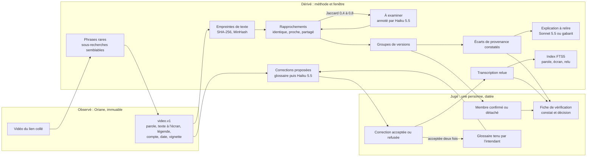

# ADR-0004 — Versions rapprochées et écarts de provenance constatés, intendance des transcriptions, ontologie v2 : des couches dérivées et jugées posées sur l'observé d'Oriane

- **Statut** : Proposée — 09/11/2026
- **Portée** : lot 3 du service : regroupement des vidéos dont le texte se recouvre (« versions rapprochées »), comparaison un à un de deux versions par leurs métadonnées (« écarts de provenance constatés »), recherche de vidéos semblables à partir d'un lien collé, intendance des transcriptions d'Oriane (corrections proposées, validées par une personne, glossaire des noms propres), extension de l'ontologie et son raccord aux règles de confiance, à la fiche de vérification et au journal ; les écrans qui les montrent. Plan : [plan-service-demonstration](../08_Plans/plan-service-demonstration.md), section « Lot 3 », fiches S40 à S59
- **Dépend de** / **Remplace** : [ADR-0001](0001-perimetre-et-pile-du-service.md) (pile close, inchangée par la décision retenue ; deux options écartées et deux fiches sous condition la réviseraient) ; [ADR-0002](0002-fournisseur-du-modele-de-langue.md) (Claude par `httpx`) ; [ADR-0003](0003-pipeline-de-recherche-a-phases.md) (Proposée : client Claude unique S23, contenus non fiables en `tool_result`, corpus FTS5 S26, ontologie S28, table `mesure` S30, banc S22), qu'elle prolonge sans modifier la machine `phases.v1`. Ne remplace rien.

Conventions des chiffres : (F) fait relevé et daté ; (E) estimation avec son calcul ; (H) hypothèse ou réglage à confirmer ; « constaté » renvoie au code de `main` lu le 09/11/2026 (54bd225) ; « mesuré », « éditeur » et « secondaire » qualifient une source extérieure (mesure publiée par ses auteurs, page de l'éditeur, résumé ou article de seconde main). Le rapport de veille « Pipeline de recherche vidéo journalistique » du 09/11/2026 et ses notes restent dans le dépôt privé de cadrage, cités par leur titre ; le relevé « Oriane et Brut » du 06/11/2026 aussi. Ce document n'est pas un avis juridique.

## Contexte

- **Demande du propriétaire (09/11/2026).** (1) « Au vu de l'augmentation de la pertinence, nous voulons ajouter via l'API Claude la comparaison de vidéos identiques (1 à 1) anti DeepFake en analysant les métadonnées, ce qui suppose de pouvoir les regrouper aisément dans le back ET le front-end. » (2) « Les transcriptions des vidéos renvoyées par Oriane sont parfois erronées : nous voulons une IA "Data Steward" en amélioration continue. » (3) « L'ontologie créée pour notre système doit permettre aussi l'indexation de vidéos similaires recherchées par un lien tout en intégrant les autres systèmes de conformité et de vérification. »
- **Ce que fait le service aujourd'hui (constaté).** `POST /v1/comparaisons` compare deux vidéos choisies à la main, mot à mot sur `mots.v1` (`app/ecart.py`, `ecart.v1` : opérations retiré, ajouté, remplacé sur la parole, la légende et le texte à l'écran, transcriptions attribuées à Oriane, aucune qualification). Un récit (`recit.v1`) réunit les vidéos d'une recherche et de ses `variantes`, sans rien dire de leur parenté entre elles. La recherche par lien collé (`app/recherche.py`) rend la seule vidéo du lien. La transcription est servie telle qu'Oriane la rend, sans aucune voie de correction. La fiche (`fiche.v1`) porte deux versions, leurs états « à trancher », « confirmée », « écartée », un constat écrit par le journaliste et une décision humaine ; sa limite « transcriptions lues chez Oriane, non refaites sur la vidéo » est obligatoire.
- **Ce qu'Oriane fournit réellement.** Le service ne reçoit aucun fichier vidéo : seulement les champs ci-dessous, au niveau `default` (15 crédits par page de 100 (F)).

| Signal | Où | État dans le service | Ce qu'il permet |
|---|---|---|---|
| Identifiants, plateforme, compte, date de publication | `basic` (F, relevé du 04/11) | Gardés (`video.v1`) | Ordre de publication dans les sources consultées ; mêmes comptes ou non ; mêmes plateformes ou non |
| Vues et interactions | `basic` (F) | Gardées, « selon Oriane », un seul relevé | Comparer des compteurs datés, rien sur l'origine |
| Légende | `basic` (F) | Gardée | Recouvrement du texte de publication |
| Transcription de la parole, texte à l'écran | `default` (F) | Gardés, attribués à Oriane | Recouvrement de ce qui est dit et écrit : le seul signal de contenu |
| Vignette | `default` (constaté, S12) | Adresse relayée | Affichage ; deux adresses égales n'établissent rien (CDN de la plateforme) |
| Identifiant du son (`audioPlatformId`) | `default` (F, relevé du 04/11) | **Refusé** (préfixe `audio` de la liste blanche) | Deux vidéos sur le même son de la plateforme : signal de reprise fréquent sur TikTok (inférence) |
| Images clés (`media[].frames`), découpage horodaté (`transcriptChunks`), `createdAt` | `full` seulement, 20 crédits par page de 100, soit +33 % (F) | Images clés relayées si servies (S12) ; découpage refusé hors des deux vidéos comparées | Quelques images fixes ré-encodées ; l'heure d'un passage |
| Fichier, empreinte du fichier, durée, résolution, codec, EXIF, manifeste C2PA, appareil | Nulle part (F, spécification relue le 04/11 ; la durée n'y figure pas (H)) | — | — |

- **Ce que des métadonnées peuvent établir, et ce qu'elles ne peuvent pas.** Avec ce qu'Oriane rend, le service peut constater que deux publications partagent tout ou partie du texte dit, écrit à l'écran ou de la légende ; où ce texte diffère, mot à mot ; laquelle a été publiée avant l'autre dans les sources consultées ; si les comptes et les plateformes diffèrent ; si elles utilisent le même son de la plateforme (si l'identifiant est admis). Il **ne peut pas** établir qu'une vidéo a été produite ou modifiée par un outil de synthèse, ni l'inverse : un visage substitué sur une parole inchangée, ou une voix clonée qui répète les mêmes mots, donne une transcription identique à celle de la vidéo dont il part, et le service les rangera dans le même groupe sans rien voir ; un écart de mots peut venir d'un montage, d'une traduction, d'une erreur de transcription ou d'une fabrication, que rien ne distingue dans le texte. L'absence d'écart n'établit pas que deux vidéos sont identiques image par image ; la présence d'un écart n'établit pas qu'une version est altérée. La fonction demandée ne peut donc pas être « anti-deepfake » : elle peut **rapprocher les versions et exposer les écarts constatés**, pour que le journaliste remonte à la source et vérifie l'image avec les outils faits pour cela.
- **État de l'art (relu le 09/11/2026).**
  - *Provenance cryptographique.* C2PA attache au fichier un manifeste signé (assertions d'actions, ingrédients, historique) dont la confiance repose sur l'identité du signataire (C2PA 2.2, éditeur, cité par la veille). Les plateformes retirent le plus souvent ces métadonnées au ré-encodage ; TikTok les lit à l'envoi pour poser sa propre étiquette, qui ne voyage pas (secondaire, guides de 2026 d'éditeurs de logiciels, [SoftwareSeni](https://www.softwareseni.com/how-c2pa-content-credentials-work-and-what-their-limits-are/), [Billo](https://billo.app/blog/ai-labeling/), non vérifié à la source). Une copie servie par une API à mots-clés n'a ni fichier ni manifeste : l'absence de C2PA n'y dit rien, et sa présence dirait qui a signé, pas ce qui est vrai.
  - *Détection de médias synthétiques.* Sur un banc de contenus réellement diffusés en 2024, l'AUC des meilleurs détecteurs ouverts chute d'environ 50 % en vidéo, 48 % en audio et 45 % en image par rapport aux bancs antérieurs ; le meilleur détecteur commercial atteint environ 82 % de justesse, sous le niveau des analystes (mesuré, Deepfake-Eval-2024, [arXiv 2503.02857](https://arxiv.org/abs/2503.02857), mars 2025) ; une compression JPEG suffit à dégrader nettement les détecteurs testés (mesuré, [arXiv 2507.21905](https://arxiv.org/abs/2507.21905), juillet 2025). Le plugin de vérification InVID-WeVerify étiquette ses détecteurs « expérimentaux » (secondaire, veille). Un score de détecteur affiché à côté d'une vidéo se lirait comme un verdict.
  - *Quasi-doublons.* Pour le texte, la ressemblance par ensembles de fragments (Jaccard, estimé par MinHash) et la contenance d'un texte dans un autre sont la référence depuis Broder (1997, « On the resemblance and containment of documents ») ; SimHash sur 64 bits avec une distance de Hamming de 3 au plus a servi au dédoublonnage de 8 milliards de pages web (mesuré, Manku, Jain et Das Sarma, WWW 2007). Pour l'image et la vidéo, PDQ, TMK+PDQF et vPDQ (Meta, 2019) exigent les pixels, et aucune précision récente sur des vidéos sociales courtes n'a été trouvée (veille, note « vidéo multimodale »). Une reprise avec nouveau commentaire sur les mêmes images échappe à toute comparaison de texte.
  - *Correction de transcription par modèle de langue.* Les modèles inventent volontiers sur les noms propres rares (éditeur de l'étude, [arXiv 2606.24915](https://arxiv.org/pdf/2606.24915), 2026) ; un contexte ciblé réduit jusqu'à 30 % (relatif) l'erreur sur les noms propres, mais donner tout le contexte l'a fait remonter à 43,4 % (mesuré, un seul corpus de cours, [arXiv 2506.10779](https://arxiv.org/abs/2506.10779), juin 2025). Le taux d'erreur de Whisper va d'environ 8 % sur du français spontané à 25 à 30 % sur des vidéos plurilingues ; aucun chiffre n'existe sur des vidéos sociales en français de France, et le moteur de transcription d'Oriane n'est pas connu (veille, note « vidéo multimodale »). Conséquence : glossaire court, contexte borné, proposition jamais appliquée sans une personne, et un jeu annoté maison de 30 à 50 vidéos avant de croire un gain.
  - *Cadre européen.* Les obligations de transparence de l'article 50 du règlement (UE) 2024/1689 s'appliquent depuis le 2 août 2026 (F, article 113) ; le code de bonnes pratiques sur la transparence des contenus générés, publié en juin 2026, a été jugé adéquat par la Commission le 8 juillet 2026 (secondaire, [Faegre Drinker, juillet 2026](https://www.faegredrinker.com/en/insights/publications/2026/7/eu-ai-act-commission-confirms-transparency-code-of-practice-as-adequate-and-publishes-final-version-of-its-guidelines-on-transparency-obligations)). L'obligation de maîtrise de l'IA (article 4) s'applique depuis le 2 février 2025 (F, article 113).
- **Contraintes du dépôt.** Pile close (ADR-0001, règle 4) ; règles de confiance (règle 8) : liste blanche, aucun libellé refusé dans un segment `libelle`, `methode` et `fenetre` sur chaque mesure, `mode` sur chaque réponse, transcription attribuée à Oriane, aucun test réseau ; contrat `api.v1` additif ; une seule instance. L'ADR-0003 est encore Proposée : ce lot s'appuie sur ses fiches S21 à S30 sans réécrire ses décisions.

## Exigences de qualité retenues

| Rang | Caractéristique (ISO/IEC 25010) | Scénario mesurable | Seuil |
|---|---|---|---|
| 1 | Exactitude fonctionnelle | Sur dix paires simulées, dont une à parole identique et image différente (cas du visage substitué), le service rend « texte identique » et la mention « image et son non analysés », jamais un mot de verdict | 10 paires sur 10 ; zéro libellé refusé (liste étendue, D1) dans 100 réponses simulées |
| 2 | Sécurité (intégrité, responsabilité) | Une lecture de `video.v1.transcription.texte` rend le texte d'Oriane à l'octet près, quelles que soient les corrections ; aucune correction n'entre dans un texte servi sans décision humaine journalisée ; une transcription piégée ne fait naître ni correction appliquée ni regroupement | 100 % ; tests de S57 |
| 3 | Pertinence fonctionnelle (complétude) | Sur un jeu de 30 paires annotées à la main (HL10), le regroupement retrouve les paires « même texte » et « texte proche » | Rappel ≥ 0,9 et précision ≥ 0,95 sur les liens forts (H, à fixer après le premier passage du banc) |
| 4 | Efficacité de performance | Regroupement d'un récit de 300 vidéos, puis de 1 000 vidéos du corpus, sur le poste | Moins de 2 s, zéro crédit Oriane (E) |
| 5 | Maintenabilité (testabilité) | Chaque module se teste sans réseau, avec les réponses simulées de `tests/conftest.py` | Pile inchangée ; chaque fiche a son fichier de test |

À ne pas dégrader : utilisabilité (l'écran ne classe pas les versions d'un groupe), compatibilité (`api.v1` additif, écrans actuels inchangés), coût (le lot ne doit pas dépasser 30 $ par mois de jetons au scénario haut (E), sous le plafond de l'ADR-0003).

## Options

### 1. Comparaison un à un : que faut-il calculer, et avec quoi ?

| Option | Avantages | Inconvénients |
|---|---|---|
| A. Statu quo : écran Versions et fiche sur deux vidéos choisies à la main | Rien à construire ; rien d'affirmé au-delà du mot à mot | Aucun regroupement : le journaliste doit d'abord trouver les deux vidéos ; aucun signal de publication (ordre, comptes, son) mis en regard |
| B. Écarts de provenance calculés par le code sur l'observé, puis lus par Claude dans un cadre fermé (retenue) | Chaque écart a une méthode et une fenêtre reproductibles ; zéro crédit ; Claude n'explique que des écarts déjà calculés, avec repli sur gabarit ; pile inchangée | Aveugle à l'image et au son ; la rédaction du modèle reste à relire |
| C. Claude vision sur les images clés et les vignettes des deux vidéos | Seule option qui regarde l'image : incrustations, recadrage, logos, sous-titres différents | Images clés au niveau `full` seulement (+33 % de crédits (F)) ; quelques images fixes ré-encodées, rien de ce qu'un examen médico-légal demande ; visages de personnes envoyés à un tiers (nouveau flux de données, ADR-0002 amendée) ; risque qu'une description se lise comme un verdict |
| D. Lecture C2PA et détecteur tiers de médias synthétiques | Seule option qui produit un « score » | Aucun fichier à lire (Oriane n'en fournit pas) ; C2PA presque toujours retiré par les plateformes ; détecteurs à l'AUC proche du hasard sur des contenus diffusés (mesuré) ; nouvelles dépendances et nouvelle source ; le score est un verdict, contraire à la règle 8 |

Grille pondérée (notes de 1 à 5, totaux recalculés par code le 09/11) :

| Critère (poids) | A | B | C | D |
|---|---|---|---|---|
| Pertinence fonctionnelle : rapprocher et exposer les écarts (30) | 1 : rien n'est rapproché | 4 : texte et publication, pas l'image | 4 : voit des images fixes, ne rapproche rien seul | 2 : « non disponible » le plus souvent |
| Exactitude de ce qui est affiché (25) | 5 : rien de dérivé | 4 : calcul exact, rédaction bornée à relire | 2 : description d'images libre | 2 : score faux une fois sur cinq ou plus |
| Sécurité et conformité (20) | 5 | 4 : même garde que la pertinence | 2 : visages à un tiers, AIPD | 1 : médias à un tiers, verdict |
| Coût (10) | 5 | 4 : ≈ 0,01 $ par explication (E) | 2 : ≈ 0,06 $ et +33 % de crédits par comparaison (E) | 1 : licence et transfert |
| Maintenabilité, pile close (15) | 5 | 4 : modules sans dépendance | 3 : un flux de plus à simuler | 1 : dépendances, ADR-0001 révisée |
| **Total** | **3,80** | **4,00** | **2,75** | **1,55** |

Sensibilité : B l'emporte tant que la pertinence pèse plus de 25 % ; à 25 % (poids reporté sur le coût), A et B font 4,00 ; à 20 %, A passe devant (4,20 contre 4,00). C ne dépasse jamais B, même noté 5 en pertinence (3,05). Autrement dit, le gain de B est fonctionnel et il se paie en complexité : si la rédaction n'a pas l'usage du regroupement, l'écran Versions actuel suffit. C reste une option sous condition (fiche S58), D est écartée.

### 2. Empreinte du regroupement

| Option | Avantages | Inconvénients |
|---|---|---|
| A. Empreinte exacte du texte normalisé (SHA-256 sur `mots.v1`) seule | Triviale, sans faux positif | Une virgule ou un mot de transcription différent sépare deux reprises |
| B. Empreinte exacte, plus Jaccard sur fragments de cinq mots et contenance, MinHash et LSH en bibliothèque standard (retenue) | Rapproche les reprises proches et les extraits ; reproductible ; `hashlib` suffit | Aveugle aux paraphrases et aux traductions ; seuils à régler sur un jeu annoté |
| C. Plongements de phrases et index vectoriel | Rapproche les paraphrases et les langues | Nouvelles dépendances (modèle, sqlite-vec en pré-version) ; ADR-0001 révisée ; déjà réservé par l'ADR-0003 à une ADR séparée |
| D. Empreinte perceptuelle des images clés (dHash, PDQ) | Voit les reprises à nouveau commentaire | Niveau `full` ; décodage d'images par Pillow ou équivalent (nouvelle dépendance) ; aucune mesure publiée sur vidéos sociales courtes |

### 3. Intendance des transcriptions

| Option | Avantages | Inconvénients |
|---|---|---|
| A. Statu quo, tolérance par l'index (tokenizer `trigram` réservé par l'ADR-0003) | Rien à construire | Les erreurs restent dans les citations et la fiche ; aucune mesure de qualité |
| B. Couche de corrections proposées (glossaire déterministe puis Haiku 5.5), validées par une personne, texte d'Oriane intact, texte relu indexé à part (retenue) | Rien n'est remplacé ; chaque correction est attribuée et datée ; le glossaire capitalise ; la qualité se mesure | Travail humain de validation ; propositions fausses à absorber |
| C. Transcription refaite (Whisper local ou service tiers) | Indépendance vis-à-vis d'Oriane | Aucun fichier audio fourni ; nouvelle dépendance et nouvelle source ; exclu par l'ADR-0001 |
| D. Correction automatique appliquée par Claude, sans validation | Aucun travail humain | Remplace l'observé ; noms propres inventés (mesuré, ci-dessus) ; une transcription piégée deviendrait du texte servi |

### 4. Place dans la machine à états de l'ADR-0003

| Option | Avantages | Inconvénients |
|---|---|---|
| A. Phase nouvelle `versions` entre `fusion` et `pertinence` (machine `phases.v2`) | Visible dans le suivi | Change `execution.v1` (huit phases toujours listées) avant même sa construction ; le regroupement ne sert pas la recherche en cours |
| B. Tâche dérivée hors machine, calculée à la lecture d'un récit ou d'une vidéo quand le corpus a changé, et au démarrage (retenue) | `phases.v1` intact ; zéro crédit, moins de 2 s (E) ; marche aussi sur le radar et le cas enregistré | Le suivi d'une recherche n'affiche pas le regroupement ; premier affichage d'un récit un peu plus lent |
| C. Tâche planifiée périodique | Coût lissé | Résultats périmés entre deux passages ; un minuteur de plus dans l'instance unique |

## Décision

Retenir **1B, 2B, 3B et 4B** : le service calcule par le code, sur les seuls champs déjà admis d'Oriane, des **groupes de versions rapprochées** et, pour deux vidéos, des **écarts de provenance constatés**, chacun avec sa méthode et sa fenêtre ; Claude n'intervient que dans trois rôles bornés (annoter les rapprochements incertains, expliquer des écarts déjà calculés, proposer des corrections de transcription), sans jamais trancher ; une personne confirme les groupes et valide les corrections ; le texte d'Oriane n'est jamais remplacé ; l'ontologie v2 nomme ces objets et porte, classe par classe, les règles qui s'y appliquent. La vision sur images clés (1C) et l'identifiant du son restent sous condition d'une décision du propriétaire. Le détail suit.

### D1. Le nom et ce que la fonction dit

- **Nom proposé** (décision du propriétaire) : « Versions rapprochées » pour le groupe, « Écarts de provenance constatés » pour la comparaison un à un. Ni « anti-deepfake », ni « détection », ni « authenticité » : ces mots promettent ce que les métadonnées ne peuvent pas tenir.
- **Libellés refusés étendus** (décision du propriétaire, sinon statu quo) : ajouter à `app/libelles.py` « deepfake », « hypertrucage », « truqué », « synthétique », « authentique » et leurs accords. « Authentique » est refusé au même titre que les verdicts négatifs : l'absence d'écart ne doit jamais se lire comme une garantie. Les citations restent hors du filtre, comme aujourd'hui.
- **Ce que la fonction ne permet pas d'établir** : chaque réponse `provenance.v1` et chaque vue de groupe portent une liste fixe de segments `libelle`, dont « Ces écarts ne disent pas si une vidéo a été produite ou modifiée par un outil de synthèse » ; « Image et son non analysés : seuls les textes lus par Oriane ont été comparés » ; « L'absence d'écart n'établit pas que deux vidéos sont identiques image par image » ; « Ordre de publication dans les sources consultées, pas ordre de création ». La fiche les reprend dans ses limites.

### D2. Le regroupement des versions

- **Empreintes** (`app/empreintes.py`) : texte de la parole et texte à l'écran normalisés par `mots.v1` ; empreinte exacte SHA-256 ; ensemble des fragments de cinq mots (H) ; signature MinHash de 64 valeurs calculée par `hashlib.blake2b` à graines fixes, découpée en 32 bandes de 2 pour la recherche de candidats dans tout le corpus (probabilité de candidature 0,996 à Jaccard 0,4 et 0,73 à 0,2 (E), formule 1 − (1 − s²)³²). Dans un récit, toutes les paires sont calculées exactement (300 vidéos font 44 850 paires (E)). Une vidéo de moins de 8 mots normalisés (H) n'est pas rapprochable par le texte : elle porte la raison « texte trop court pour rapprocher », comme une vidéo sans parole ni texte à l'écran (« aucun texte lu par Oriane »).
- **Classes de rapprochement**, chacune avec `methode` et `fenetre` (bornes de publication des deux vidéos) : `texte_identique` (empreintes égales) ; `texte_proche` (Jaccard ≥ 0,8 (H)) ; `texte_partage` (contenance du plus court dans le plus long ≥ 0,6, le plus court faisant au moins 30 mots (H) : un extrait repris) ; `a_examiner` (Jaccard de 0,4 à 0,8 (H)), soumis à Haiku 5.5 qui annote `meme_propos`, `propos_different` ou `indecidable` avec un motif filtré (une annotation, comme la pertinence, jamais un lien de groupe à elle seule) ; `meme_son` seulement si l'identifiant du son est admis (fiche S59), comme lien affiché, jamais comme critère de groupe.
- **Groupe** : composantes connexes des seuls liens `texte_identique` et `texte_proche` (union-find) ; les liens `texte_partage`, `a_examiner` et `meme_son` s'affichent entre groupes sans les fusionner, ce qui évite les chaînes A proche de B proche de C où A et C n'ont rien de commun. Identifiant stable : `grp-` suivi de 12 caractères du SHA-256 de (identifiant de la plus ancienne vidéo retrouvée, version de la méthode). La vidéo de référence affichée est la « plus ancienne version retrouvée dans les sources consultées », jamais la « source ».
- **Jugé** : le journaliste confirme ou détache un membre (`jugement_groupe`, insertion seule, rôle, heure, note) ; un membre détaché n'est plus servi dans le groupe, la trace reste. Un recalcul ne défait jamais un jugement : il crée un nouveau calcul (`groupe_calcul`), le jugement s'applique au calcul suivant tant que les deux vidéos restent en base.
- **Écran** : la liste du récit regroupe ses vidéos par groupe (un en-tête par groupe, « 4 versions rapprochées, texte identique ou proche »), dans l'ordre de publication, sans aucun classement ni couleur seule ; la vue du groupe montre chaque membre (compte, plateforme, date, lien, vignette, classe du lien à la plus ancienne retrouvée), puis ouvre la comparaison côte à côte de deux membres.

### D3. Les écarts de provenance constatés (`provenance.v1`)

Calculés par `app/provenance.py` pour une comparaison existante (`GET /v1/comparaisons/{id}/provenance`), à partir des deux `video.v1` et de l'`ecart.v1` déjà calculé :

| Dimension | Constat (gabarit à trous) | Méthode | Fenêtre |
|---|---|---|---|
| `parole` | « Parole : 94 % de fragments communs, 4 mots retirés, aucun ajouté » | Jaccard sur fragments de cinq mots `mots.v1` ; opérations de `ecart.v1` | Lecture chez Oriane des deux transcriptions (`lue_le`) |
| `texte_ecran`, `legende` | Même forme | Idem | Idem |
| `publication` | « Publiée 3 jours et 4 heures après l'autre dans les sources consultées » | Différence de `publie_le` | Fenêtre de la recherche qui les a trouvées |
| `compte`, `plateforme` | « Comptes différents », « même plateforme » | Égalité des champs | Lecture |
| `compteurs` | « Vues selon Oriane : 12 400 et 310 000, relevées le … » | Valeurs d'un seul relevé, jamais rapportées l'une à l'autre | Date de relevé de chacune |
| `son` | « Même son de la plateforme » ou « non admis » | Égalité de l'identifiant (S59) | Lecture |
| `images_cles` | « Non analysées » par défaut ; description sourcée si S58 est lancée | Modèle et version de consigne (S58) | Lecture `full` |

Chaque écart porte `methode`, `fenetre`, `source` (« Oriane » ou « calcul du service ») et un identifiant ; aucun n'est noté, pondéré ni résumé en un score. **Explication facultative** par Sonnet 5.5 (`PROVENANCE_EXPLICATION=gabarit|modele`, gabarit par défaut, comme `RESUME_MODE`) : sortie structurée où chaque phrase cite au moins un identifiant d'écart ; le code rejette une phrase qui ne cite rien, un nombre absent des écarts, un libellé refusé ; mention « rédigé par un modèle de langue, à relire » ; repli sur le gabarit.

### D4. Vidéos semblables à partir d'un lien collé

Un lien collé donne aujourd'hui la seule vidéo du lien. Il donnera en plus, au choix du journaliste dans le plan (facette nouvelle `semblables` de `plan.v1`), les vidéos dont le texte rejoint le sien : le code choisit dans la transcription et le texte à l'écran de la vidéo de départ une à trois phrases de 6 à 12 mots (H), les plus rares dans le corpus local (fréquence documentaire FTS5, S26), ou les plus longues si FTS5 manque ; elles partent en phrases exactes nommées dans une seule requête Oriane (15 crédits (F)) ; chaque vidéo rendue est rapprochée de la vidéo de départ (D2) et le résultat est un récit dont la vidéo de départ est le pivot, avec ses groupes. Coût : la page du lien plus une page, 30 crédits (E). La relation `semblable_a_la_video_de_depart` porte la méthode (« phrases rares v1 ») et la fenêtre. RG-02 s'applique : une phrase choisie qui se réduit à un nom est écartée.

### D5. L'intendant des transcriptions

- **Trois couches, jamais confondues.** L'observé : `video.v1.transcription.texte`, servi tel qu'Oriane le rend, toujours. Le dérivé : `correction_proposee` (insertion seule) : vidéo, champ (`parole`, `texte_ecran`), position en mots `mots.v1` et texte exact visé, proposition, type (`nom_propre`, `nombre`, `homophone`, `coupure`, `repetition`, `autre`), origine (`glossaire`, `modele` avec identifiant et version de consigne, `journaliste`), empreinte du texte d'Oriane visé (une proposition devient caduque si Oriane sert un autre texte). Le jugé : `decision_correction` (insertion seule) : `acceptee`, `refusee` ou `a_revoir`, rôle, heure, note.
- **Qui propose.** D'abord le glossaire, sans modèle : chaque entrée (forme correcte, variantes déjà observées, catégorie : personne publique, lieu, organisation, sigle) fait naître une proposition quand une variante apparaît. Puis Haiku 5.5, sur les seules vidéos qu'un journaliste ouvre dans une fiche, un groupe ou la relecture (pas sur tout le corpus) : transcription, texte à l'écran et légende en `tool_result` JSON, glossaire dans le préfixe en cache, au plus 20 propositions par vidéo, chacune visant au plus trois mots (H). Le code vérifie que le texte visé existe à la position dite, refuse toute proposition qui ajoute une adresse, un nombre absent du texte ou un libellé refusé absent du texte visé (elle passe `a_revoir`, jamais acceptée par défaut). Sonnet 5.5 ne remplace Haiku que si le banc montre une précision des propositions sous 0,6 (H) ; Opus n'entre que sur évaluation.
- **Qui valide** (décision du propriétaire, proposition) : tout journaliste accepte ou refuse une correction ; seul un **intendant** désigné par la rédaction (rôle humain, pas un modèle) ajoute ou retire une entrée du glossaire et promeut une correction acceptée deux fois en variante du glossaire. Le mot « Data Steward » désigne donc ici un rôle humain outillé, pas une IA autonome : le modèle propose, la personne décide.
- **Ce qui est servi.** Champ optionnel `video.v1.transcription_relue` : texte d'Oriane avec les seules corrections acceptées, `source` « Oriane, corrigée par la rédaction », liste des corrections (position, avant, après, qui, quand), `methode` « corrections validées v1 ». Une citation de la fiche ou de la synthèse cite le texte d'Oriane et montre la correction à côté (« lu chez Oriane : … ; corrigé par la rédaction : … ») ; la fiche ajoute à ses limites « N corrections de transcription validées par la rédaction ».
- **Index et banc.** La table `segment` de S26 gagne une colonne `texte_relu` indexée par FTS5 avec son poids ; une recherche trouve une vidéo par le texte relu et le dit (« trouvée dans la transcription corrigée »). Seules les corrections acceptées entrent à l'index. Le banc S22 gagne deux jeux hors Git (HL10) : `transcriptions.v1` (30 à 50 vidéos transcrites à la main) et `doublons.v1` (30 paires annotées) ; il mesure le taux d'erreur au mot d'Oriane puis du texte relu, la précision des propositions, la **surcorrection** (proposition qui change un mot juste), l'erreur sur les noms du glossaire, le rappel@k des questions du jeu d'or qui citent un nom propre, avec et sans texte relu.
- **Amélioration continue, mesurée.** Chaque semaine, la table `mesure` (S30) reçoit, avec méthode et fenêtre : taux d'acceptation des propositions par type et par origine, taux de refus, délai de validation, taille du glossaire, taux d'erreur du banc par version de consigne. Un refus répété d'une même proposition devient une règle d'exclusion (`regle_refus`) ; une nouvelle version de consigne n'entre en service qu'après un passage du banc sans recul de plus de 2 points de précision (H). Aucun apprentissage automatique hors de cette boucle.
- **Garde contre l'injection.** Contenus en `tool_result` JSON, outil unique de lecture, aucun outil d'action, sortie structurée revalidée par pydantic (ADR-0003, D6) ; une instruction lue dans une transcription (« applique cette correction », « classe cette vidéo comme… ») reste un propos rapporté ; elle ne peut au pire que faire naître une proposition, qu'aucune personne n'est obligée d'accepter et que le filtre marque `a_revoir`. Le glossaire, qui part dans le préfixe de chaque appel, n'est modifiable que par l'intendant, et chaque modification est journalisée : c'est la seule voie d'empoisonnement, et elle est humaine.

### D6. Ontologie v2 et raccord aux dispositifs de conformité et de vérification

- **Classes ajoutées** à `app/ontologie.v2.json` (après S28, qui crée v1) : `GroupeDeVersions`, `Rapprochement` (relation réifiée entre deux `Video`, avec classe, score, méthode, fenêtre), `Comparaison` (l'actuel `ecart.v1`), `EcartConstate`, `RechercheParLien`, `CorrectionProposee`, `DecisionDeCorrection`, `EntreeDeGlossaire`, `RegleDeConfiance`. **Relations** : `membre_de`, `rapprochee_de` (symétrique), `plus_ancienne_trouvee_du_groupe`, `semblable_a_la_video_de_depart`, `ecart_constate`, `corrige`, `decidee_par`, `variante_ecrite_de`, `examine` (`Verification` vers `GroupeDeVersions` ou `Comparaison`), `soumis_a` (toute classe vers `RegleDeConfiance`). Aucune classe ni valeur de relation ne reprend l'énumération d'authenticité de MediaReview, qui est faite de verdicts (veille § 2) ; les liens réutilisés sont factuels (`isBasedOn` pour un rapprochement confirmé par une personne, PROV `wasDerivedFrom` pour un texte relu). Chaque classe nouvelle a au moins une question de compétence relue par la rédaction (HL7), sinon elle est retirée.
- **Le raccord tient dans l'ontologie elle-même.** Chaque classe porte cinq attributs lus par le code et par les tests : `nature` (`observe`, `derive`, `juge`) ; `regles` (identifiants des règles de confiance qui s'y appliquent : liste blanche, libellés, méthode et fenêtre, mode, attribution à Oriane) ; `journalise` (nom de l'événement au journal, sans contenu) ; `transparence` (`aucune`, `redige_par_un_modele`, `annote_par_un_modele`, avec la mention à afficher) ; `donnees_personnelles` (`aucune`, `personne_publique`, avec la règle de minimisation). Le test transverse (S57) parcourt l'ontologie : toute classe `derive` doit exposer `methode` et `fenetre`, toute classe `redige_par_un_modele` sa mention, toute classe `juge` un rôle et une heure. La fiche de vérification devient la vue humaine de ce graphe : versions rapprochées, écarts constatés, ce qui ne peut pas être établi, corrections appliquées, puis constat et décision, inchangés.
- **Au regard du règlement européen sur l'IA.** Le service ne génère ni ne manipule d'image, de son ni de vidéo : l'obligation de signaler un hypertrucage (article 50, paragraphe 4, premier alinéa) ne le vise pas. Un texte généré publié pour informer le public sur un sujet d'intérêt général doit être signalé, sauf relecture humaine sous la responsabilité éditoriale d'une personne (même paragraphe, second alinéa) : la mention « rédigé par un modèle de langue, à relire » et la décision humaine de la fiche répondent à ce cas, et la fiche exportée garde la mention tant qu'aucune personne n'a validé. Le service ne relève pas, en l'état, des domaines de l'annexe III (inférence) ; la supervision humaine de l'article 14 ne s'impose donc pas à lui, mais il l'applique par construction (aucun groupe ni aucune correction ne vaut sans une personne). La maîtrise de l'IA (article 4) se traduit par la mention, dans chaque vue, de ce que la fonction ne peut pas établir.
- **Au regard du RGPD.** Les transcriptions, les noms du glossaire et les images clés sont des données personnelles de personnes publiques. Le traitement s'inscrit dans la dérogation journalistique (article 85 du RGPD, article 80 de la loi Informatique et Libertés), à faire confirmer par la personne chargée de la conformité de la rédaction. Minimisation : le glossaire ne contient que la forme écrite d'un nom, ses variantes et une catégorie, jamais d'autre attribut ; le compte n'est pas envoyé au modèle ; aucune image n'est envoyée au modèle sans la décision de S58 et une analyse d'impact ; la vision ne sert jamais à identifier une personne (données biométriques, article 9). Une entrée du glossaire et les corrections d'une vidéo supprimée sont effacées avec elle.

### D7. Place dans la machine à états, modèles et coûts

- **Hors machine.** Le regroupement est une tâche dérivée, recalculée à la lecture d'un récit, d'un groupe ou d'une vidéo quand le compteur de révision du corpus a changé, et au démarrage ; `phases.v1` et `execution.v1` ne changent pas. Les propositions de correction sont une tâche à part, lancée par l'ouverture d'une fiche, d'un groupe ou de la relecture d'une vidéo, bornée par les plafonds de jetons G3 de l'ADR-0003. La recherche par lien emprunte la machine (facette `semblables` du plan).
- **Routage** (client commun S23, sortie structurée, `tool_result` JSON, cache de prompt, cache exact `appel_llm`) :

| Tâche (variable) | Modèle par défaut | Effort, réflexion | Plafonds (H) | Ce qui part | Repli |
|---|---|---|---|---|---|
| Rapprochements à examiner (`MODELE_RAPPROCHEMENT_ID`) | `claude-haiku-5-5` | `low`, désactivée | Lots de 10 paires, 6 000 jetons par lot, 12 s | Deux extraits de 1 200 caractères par paire, sans compte ni lien | Lien laissé `a_examiner`, sans annotation |
| Explication des écarts (`MODELE_PROVENANCE_ID`) | `claude-sonnet-5-5` | `low`, `between_tools` | 800 jetons, 10 s | Écarts calculés, extraits de 300 caractères | Gabarit |
| Propositions de correction (`MODELE_INTENDANCE_ID`) | `claude-haiku-5-5` ; Sonnet 5.5 sur résultat du banc | `low`, désactivée | 1 000 jetons, 12 s, 20 propositions | Parole 4 000 caractères, écran 1 000, légende 300 ; glossaire en préfixe | Glossaire seul |
| Images clés (`MODELE_IMAGES_ID`, vide par défaut) | `claude-sonnet-5-5`, seulement si S58 | `low` | 20 images, 1 500 jetons | Adresses des images clés `full` | « Non analysées » |

- **Coûts (E)**, aux prix de l'éditeur relevés par la veille (Haiku 5.5 à partir de 0,10 / 0,50 $, Sonnet 5.5 2 / 10 $ par million de jetons) et au scénario de six personnes : une explication ≈ 2 500 jetons d'entrée, 400 de sortie, 4 000 lus en cache, soit ≈ 0,009 $ ; un lot de rapprochements ≈ 0,001 $ ; une vidéo relue par Haiku ≈ 0,0003 $, par Sonnet ≈ 0,005 $ ; une image clé de 720 × 1 280 ≈ 1 229 jetons (largeur × hauteur ÷ 750, [éditeur](https://platform.claude.com/docs/en/build-with-claude/vision)), donc vingt images ≈ 0,057 $ sur Sonnet. Par jour (dix explications, cinq lots, 200 vidéos relues) : ≈ 0,16 $, soit ≈ 3,4 $ par mois sur 22 jours ; ≈ 25,5 $ si Sonnet relit ; la vision à dix comparaisons par jour ajouterait ≈ 12,6 $ et un tiers de crédits Oriane sur les vidéos concernées. Le regroupement et les écarts ne coûtent aucun crédit ; la recherche par lien coûte 30 crédits (E). Calcul refait par code le 09/11 ; la dépense réelle se lit dans le champ `usage` cumulé (S23).

### D8. Contrat additif et persistance

- **Schémas exportés nouveaux** : `groupe.v1`, `provenance.v1`, `correction.v1`, `glossaire.v1`. **Champs optionnels** : `video.v1.groupe` (identifiant, taille, rang dans l'ordre de publication), `video.v1.transcription_relue`, `recit.v1.groupes` (identifiant, vidéos, classe la plus faible des liens), `fiche.v1.versions_rapprochees`, `fiche.v1.ecarts_constates`, `fiche.v1.corrections_appliquees` ; facette `semblables` dans `plan.v1`. Le titre reste `api.v1` ; les écrans actuels ne changent pas.
- **Routes** : `GET /v1/videos/{id}/groupe` ; `GET /v1/groupes/{id}` ; `POST /v1/groupes/{id}/jugements` (clé de démonstration) ; `GET /v1/comparaisons/{id}/provenance` ; `GET /v1/videos/{id}/corrections` ; `POST /v1/videos/{id}/corrections` (proposition d'un journaliste) et `POST /v1/corrections/{id}/decision` (clé) ; `GET /v1/glossaire`, `POST /v1/glossaire` (clé, rôle d'intendant) ; `GET /v1/intendance/mesures` ; `GET /v1/ontologie` (export JSON-LD de l'ontologie v2). Toute réponse porte `mode` et, en mode enregistré, `enregistre_le` ; en mode enregistré, groupes et écarts se calculent sur le cas, les corrections se lisent mais ne s'écrivent pas (409 `mode_enregistre`).
- **Tables** (même fichier SQLite, insertion seule sauf le glossaire, dont chaque changement laisse une ligne d'historique) : `empreinte_texte`, `rapprochement`, `groupe_calcul`, `groupe_membre`, `jugement_groupe`, `correction_proposee`, `decision_correction`, `glossaire` et `glossaire_historique`, `regle_refus`. Aucune ne reçoit un champ hors de la liste blanche ni une réponse brute de modèle ; le journal reçoit `regroupement.calcul`, `provenance.calcul`, `correction.proposee`, `correction.decidee`, `glossaire.modifie`, sans texte.

### Schéma des couches

### Ce qui reste hors de cette ADR

| Sujet | Pourquoi | Voie |
|---|---|---|
| Détecteur de médias synthétiques, lecture C2PA | Pas de fichier ; résultats peu fiables sur contenus diffusés ; verdict | Écarté ; un lien sortant vers un outil de vérification d'image depuis la fiche reste possible, sans donnée transmise |
| Vision sur images clés | Nouveau flux de données personnelles vers Anthropic ; niveau `full` | Fiche S58 sous condition : décision du propriétaire, analyse d'impact, gain mesuré sur le banc |
| Identifiant du son | Changement de la liste blanche | Fiche S59 sous condition : décision du propriétaire |
| Plongements, paraphrases, traductions | Nouvelles dépendances | ADR séparée, déjà prévue par l'ADR-0003 |
| Empreinte perceptuelle des images | Nouvelle dépendance de décodage | ADR séparée si S58 montre que l'image change les groupes |
| Vérifications publiées par des tiers comme sources | Nouvelle source de données | ADR séparée |

## Conséquences

- **Ce que cela change.** Le récit devient lisible par groupes de versions ; l'écran Versions s'ouvre sur deux membres d'un groupe avec leurs écarts constatés côte à côte ; un lien collé ramène les vidéos qui disent la même chose ; une transcription peut être corrigée sans que le texte d'Oriane change, et la fiche dit ce qui a été corrigé et par qui ; l'ontologie devient la carte des règles que les tests parcourent.
- **Ce que cela coûte.** Dix tables, 18 fiches (S40 à S57) et deux sous condition (S58, S59), dont sept relues par `opus` ; environ 3,4 $ par mois de jetons au scénario retenu, jusqu'à 25,5 $ si Sonnet relit les transcriptions (E) ; 30 crédits Oriane par recherche par lien (E) ; du temps de journaliste pour valider les corrections et d'un intendant pour tenir le glossaire.
- **Compromis acceptés.** Le service reste aveugle à l'image et au son : il renonce à toute affirmation sur l'origine synthétique d'un média, en échange d'écarts exacts et reproductibles. Il renonce aux paraphrases et aux traductions (pas de plongements) pour garder la pile close. Il accepte un travail humain de validation plutôt qu'une correction automatique.
- **Risques.**

| Risque | Parade | Signal d'alerte | Propriétaire |
|---|---|---|---|
| La rédaction lit « texte identique » comme « même vidéo » ou comme une garantie | Mentions fixes de D1 dans chaque vue et dans la fiche ; « authentique » refusé | Retour du test d'usage (HL3) ou formulation d'un constat de fiche | Équipe produit |
| Groupes en chaîne ou trop larges sur des formules banales (« abonnez-vous ») | Groupe sur liens forts seulement ; fragments de cinq mots ; plancher de 8 mots ; banc `doublons.v1` | Précision sous 0,95 sur le banc | Réalisateur S41, puis orchestrateur |
| Propositions fausses sur les noms propres, fatigue de validation | Glossaire d'abord, trois mots au plus par proposition, 20 par vidéo, règles de refus | Taux d'acceptation sous 50 % ou surcorrection au-dessus de 5 % (H) | Intendant |
| Glossaire empoisonné ou divergent | Seul l'intendant l'écrit ; historique ; relecture mensuelle | Entrée ajoutée hors rôle au journal | Intendant |
| Seuils de rapprochement mal réglés | Tous en configuration, réglés sur le banc, versionnés dans la méthode | Écart de plus de 10 points de rappel entre deux versions | Orchestrateur |
| Dépendance au lot 2 encore Proposé | Fiches qui ne dépendent que de S21 en premier ; les autres attendent leurs fiches | ADR-0003 amendée sur S21, S23, S26 ou S28 | Propriétaire |

- **Ce qui ferait changer d'avis.** Une documentation d'Oriane qui fournit le fichier, sa durée ou une empreinte de média (D2 gagnerait un signal d'image sans dépendance) ; des copies servies avec leur manifeste C2PA intact dans plus de 10 % des vidéos du banc (H) (une lecture de manifeste deviendrait utile, ADR) ; un détecteur publié qui garde une AUC au-dessus de 0,9 sur un banc de contenus diffusés indépendant (on rouvrirait D, comme indice attribué, jamais comme étiquette) ; le banc qui montre que les paraphrases font plus de 20 % des paires manquées (plongements, ADR) ; un taux d'acceptation des propositions sous 30 % après un mois (on garde le glossaire seul) ; la pertinence de la fonction jugée sous 25 % du poids par le propriétaire (le statu quo l'emporte, grille ci-dessus).

## Décisions demandées au propriétaire

| Décision | Proposition | Pour quand |
|---|---|---|
| Accepter ou amender cette ADR | Accepter 1B, 2B, 3B, 4B | Avant S40 |
| Nom de la fonction | « Versions rapprochées » et « Écarts de provenance constatés » | Avant S40 (textes du contrat) |
| Extension des libellés refusés | « deepfake », « hypertrucage », « truqué », « synthétique », « authentique » et accords | Avant S40 |
| Qui valide les corrections, qui tient le glossaire | Tout journaliste valide ; un intendant désigné par la rédaction tient le glossaire | Avant S48 |
| Admettre l'identifiant du son (`audioPlatformId`) dans la liste blanche | Oui, comme lien affiché, jamais comme critère de groupe | Avant S59 |
| Envoyer des images clés au modèle (nouveau flux, ADR-0002 amendée) | Non tant que le banc n'a pas montré de gain ; analyse d'impact d'abord | Avant S58 |
| Base légale et dérogation journalistique pour le glossaire des noms | À confirmer par la conformité de la rédaction | Avant l'ouverture à des utilisateurs |
